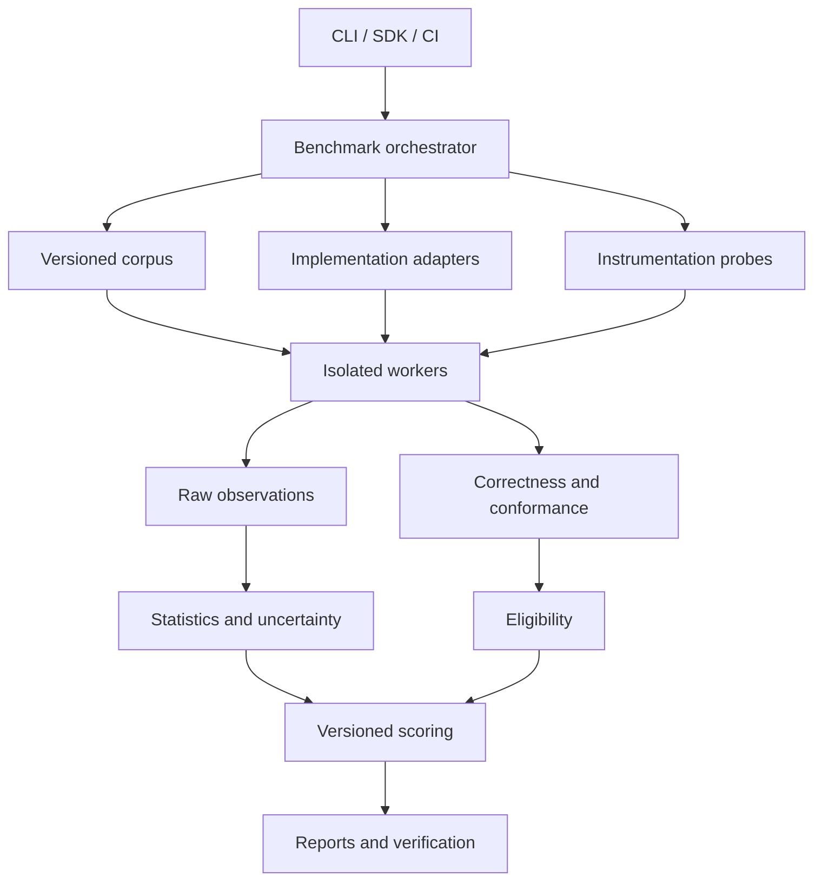

# Isobar

**Different algorithms. Equal conditions.**

An independent, open-source testing framework for lossless compression, codecs, archive formats, and their implementations.

> **Project status: pre-alpha.** The trusted local gzip worker and conformance fixtures are available. The broader CLI, benchmark suites and scoring profiles are proposals.

## Why Isobar?

Compression is a multidimensional engineering problem. Smaller output is useful, but so are fast decoding, predictable memory usage, low energy consumption, interoperability, and reliable recovery. A single number cannot capture every workload.

Existing tools provide valuable performance measurements. Isobar aims to complement them with a common, versioned testing protocol, portable adapters, correctness gates, transparent statistics, and independently inspectable evidence.

An isobar is a line connecting points of equal pressure. The name reflects the project's central principle: compare different implementations under equivalent, explicitly documented conditions.

## Design principles

- **Independent:** No privileged codec, vendor, language, or application.
- **Correctness first:** Invalid output is ineligible for competitive performance scores.
- **Reproducible:** Pin inputs, builds, configurations, methodology, and environment.
- **Transparent:** Retain raw observations alongside derived scores.
- **Comparable:** Compare equivalent workloads and measurement boundaries.
- **Extensible:** Open adapter, instrumentation, corpus, and scoring contracts.
- **Versioned:** Never silently change a score, corpus, or benchmark definition.
- **Offline-capable:** The local harness should not require an account or hosted service.
- **Honest about uncertainty:** Report limitations and variability rather than implying false precision.

## Scope

| Layer | Examples |
| --- | --- |
| Codec implementations | Zstandard, zlib, Brotli, LZ4, XZ |
| Archive formats | ZIP, TAR, 7z |
| Libraries and bindings | Native, Rust, C, Swift, Python |
| Applications | Command-line and desktop archive utilities |
| Accelerated implementations | SIMD, GPU, FPGA, dedicated hardware |
| Learned compression | Statistical and neural predictors |

These are candidate integration targets, not a list of supported adapters. Raw in-memory codec measurements and end-to-end application measurements belong to separate comparison classes.

### Planned test suites

| Suite | Measurements and checks |
| --- | --- |
| Performance | Ratio, encode/decode throughput, latency, memory, CPU and energy |
| Conformance | Exact round trips, reference vectors, interoperability, metadata fidelity |
| Security | Safe rejection, bounded resources, extraction containment, fuzz integration |
| Resilience | Corruption propagation, recoverable data, truncation and interruption |
| Information theory | Model-relative entropy, redundancy, dictionary/model overhead, expansion |
| Archive operations | Listing, searching, selective extraction, random access |

The initial release will focus on lossless codecs and a small reproducible performance/conformance suite. Additional suites will follow as their protocols mature. Lossy compression quality assessment is outside the initial scope.

## Proposed architecture



The proposed reference implementation is a Rust workspace with a language-independent adapter protocol. Native, subprocess, FFI and WASM adapters may be introduced incrementally. Process isolation alone is not a security sandbox; untrusted inputs and adapters require appropriate platform-specific containment.

Execution, validation, analysis and scoring remain distinct. A new scoring definition should be applicable to historical observations whenever those observations satisfy its requirements.

## Measurement methodology

The specification will define:

- Monotonic timing, clock resolution, warm-up, sampling, randomized execution order and timed boundaries.
- Separate in-memory and end-to-end profiles, including allocation, initialization and I/O where relevant.
- Complete byte accounting: payloads, headers, metadata, indexes, padding, required dictionaries and models. External dependencies require explicit amortization policies.
- Thread budgets, hardware topology, compiler flags, versions, thermal conditions and cache policy.
- Exact byte-for-byte lossless verification and format-specific interoperability checks.
- Raw trials, aggregate ratios computed from total bytes, distributions, uncertainty and explicit workload weighting.
- Versioned corpus manifests, content hashes, provenance, redistribution rights and training/evaluation separation.

Missing or unsupported measurements must be represented explicitly, never silently replaced with zero. Failed runs must remain visible. Comparability and uncertainty rules must precede ranking.

## Metrics and scoring

| Metric | Definition / direction |
| --- | --- |
| Compression ratio | Original bytes / compressed bytes; higher |
| Space savings | 1 − compressed bytes / original bytes; higher |
| Encoding throughput | Original bytes / encoding elapsed time; higher |
| Decoding throughput | Reconstructed bytes / decoding elapsed time; higher |
| Peak memory | Defined process or system memory measurement; lower |
| Energy | Joules per defined unit of work; lower |
| Access latency | Time to retrieve specified data; lower |
| Worst-case expansion | Output overhead on specified difficult inputs; lower |
| Recovery | Fraction of original data correctly recovered under defined damage |
| Pareto frontier | Non-dominated configurations across specified dimensions |

### Historical Weissman score

The Weissman score combines compression ratio and encoding time relative to a reference:

$$W=\\alpha\\frac{R}{R_0}\\frac{\\log T_0}{\\log T}$$

Its numerical value depends on the chosen time unit, and the logarithmic denominator becomes singular at a numeric time of one. Historical compatibility therefore requires an explicit unit, reference, scaling constant and valid domain. Isobar should preserve these limitations in its documentation rather than treat this score as a universal measure.

### Proposed normalized composite

A dimensionless weighted geometric mean is one candidate for application-specific scoring:

$$S=100\\prod_{i=1}^{n}q_i^{w_i},\\qquad w_i\\geq0,\\quad\\sum_iw_i=1$$

For higher-is-better metrics, $q_i=x_i/x_{i,0}$; for lower-is-better metrics, $q_i=x_{i,0}/x_i$. All included quantities must be finite and strictly positive. The reference configuration scores 100. Missing required measurements make a profile unavailable unless its versioned specification explicitly defines another policy.

The weights are normative choices, not scientific constants. Archival storage, real-time streaming, embedded systems and random-access workloads warrant distinct profiles. Raw measurements, qualification status and uncertainty remain primary; composite scores are supplemental.

Pareto analysis will identify configurations that cannot be improved in one selected dimension without sacrificing another, subject to comparable conditions and measurement uncertainty.

## Proposed specifications

| ID | Scope |
| --- | --- |
| IBS-0001 | Benchmark execution and measurement methodology |
| IBS-0002 | Implementation adapter protocol and capability negotiation |
| IBS-0003 | Result schema, provenance and evidence bundles |
| IBS-0004 | Metric definitions, scoring mathematics and conformance vectors |

Identifiers are provisional. Specifications will be independently versioned, with documented compatibility and change policies.

The [research ledger](research/README.md) links to pinned source reviews and reproduced findings. The [experimental conformance suite](conformance/README.md) exercises draft evidence schemas, scoring and gzip/Zstandard artifact vectors. The [trusted local worker](worker/README.md) runs a single in-memory gzip measurement with exact reconstruction and a worker timeout. It can emit [experimental IBS-0003 evidence](conformance/README.md#verify-worker-evidence) for independent verification.

## CLI design

The prototype runs with `python3 -B worker/measure.py`. The proposed CLI below describes the broader interface.

```sh
isobar corpus fetch silesia canterbury
isobar run --codecs zstd,gzip,brotli,lz4 --corpus silesia --profile standard
isobar test --suite conformance
isobar compare baseline.json candidate.json
isobar score ./results --profile archival
isobar report ./results --format html
isobar verify ./results
```

## Reproducible evidence

A proposed result bundle:

```text
results/
  manifest.json
  environment.json
  methodology.json
  corpus.lock
  implementations.lock
  measurements.jsonl
  validation.json
  statistics.json
  scores.json
  checksums.sha256
  report.html
```

A verification command should distinguish schema validation, checksum verification, score recalculation and independent experimental reproduction. A checksum alone does not establish the authenticity or scientific validity of a benchmark.

## Roadmap

- [ ] **M0 — Foundations:** audit existing tools, define specifications, threat model, result schema and conformance fixtures.
- [ ] **M1 — Vertical slice:** working CLI, isolated workers, pinned reference codecs, deterministic corpus fixtures, timing, size and exact round-trip validation.
- [ ] **M2 — Measurement:** repeated trials, uncertainty, environment capture, reproducibility and memory instrumentation.
- [ ] **M3 — Scoring:** historical Weissman compatibility, normalized profiles, Pareto analysis and independent score verification.
- [ ] **M4 — Extended testing:** interoperability, archive operations, resilience and defensive testing.
- [ ] **M5 — Ecosystem:** adapter SDK, documentation, CI regression workflows and standalone HTML reporting.
- [ ] **M6 — Registry:** optional public submissions, evidence review and independent reproduction.

Target platforms are Linux, macOS and Windows. Platform support and instrumentation availability will be reported separately rather than assumed.

## Related work

Isobar builds on a rich ecosystem of compression research and tooling. These projects are useful references and potential sources of interoperability or methodological guidance:

- [lzbench](https://github.com/inikep/lzbench)
- [TurboBench](https://github.com/powturbo/TurboBench)
- [Squash](https://github.com/quixdb/squash)
- [Weissman score calculator](https://github.com/lorenzosaino/weissman-score)
- [Large Text Compression Benchmark](https://mattmahoney.net/dc/text.html)
- [Hutter Prize](https://prize.hutter1.net/)
- [Canterbury Corpus](https://corpus.canterbury.ac.nz/)
- [Silesia Corpus](https://sun.aei.polsl.pl/~sdeor/index.php?page=silesia)

This list is not an endorsement or a claim of completed source-code review. Existing tools should be evaluated before duplicating functionality.

## Contributing

Early contributions are welcome, especially benchmark methodology, mathematical review, adapter protocol design, corpus licensing, reproducible fixtures and cross-platform instrumentation.

Open an [issue](https://github.com/zachshallbetter/isobar/issues) describing the problem, supporting evidence, proposed approach and acceptance criteria. For measurement changes, include raw observations and enough configuration detail to attempt reproduction. Avoid publishing confidential data, proprietary corpora without permission, or misleading comparative claims.

## Independence and licensing

Isobar is intended to be a standalone, vendor-neutral project. Rind and other archive implementations may participate through the same public adapter and testing contracts; none should receive preferential scoring or execution conditions.

The intended license for original code is MIT OR Apache-2.0. Formal license files have not yet been added; this statement records the planned licensing model, not an existing license grant. Third-party code and corpora will retain their own applicable terms.

---

**Isobar — compression, objectively measured.**
